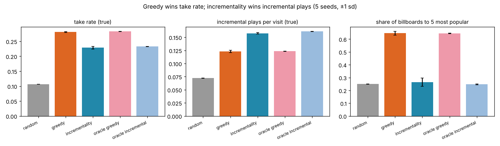
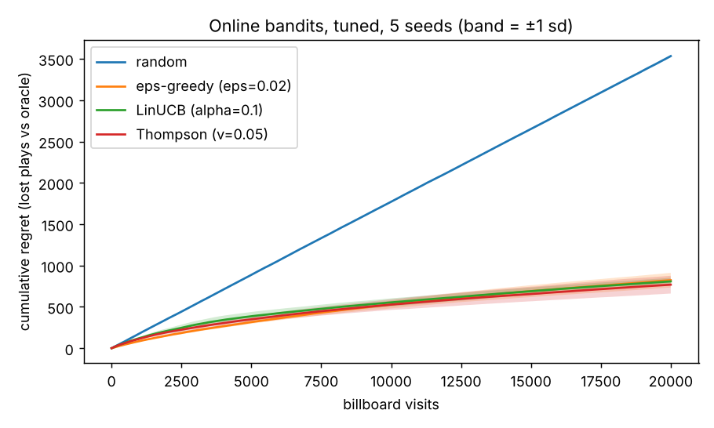
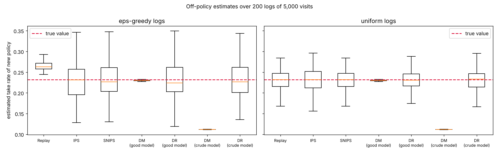

# I rebuilt Netflix's billboard bandit. The metric picked the winner.

## Greedy vs incremental, three bandit algorithms, and an offline test that misleads on the wrong logs

*Part 2 of Netflix Tech Blog, rebuilt. [Part 1: artwork personalization](https://medium.com/@faycal.zouine.usa/i-rebuilt-netflixs-artwork-personalization-system-on-movielens-here-s-what-actually-matters-d0540b7c43eb) · [Part 3: what recommendations are worth](https://medium.com/@faycal.zouine.usa/your-dashboard-says-recommendations-multiply-viewing-by-7-5-the-truth-is-3-1-a7b68e8334c3)*

The big banner at the top of the Netflix homepage shows one title per member. Netflix described how they choose it in [a talk at AI Council](https://aicouncil.com/talks/a-multi-armed-bandit-framework-for-recommendations-at-netflix): a bandit that usually shows the title its model likes best and occasionally shows a random one from a candidate pool, so it keeps learning and collects clean data at the same time. I run an offer bandit at work, so I was curious how their choices would hold up in a setup where I could check them.

The talk compares two ways of deciding which title is best. The first picks the title a member is most likely to play. The second picks the title whose chance of being played goes up the most because it is on the billboard. The difference matters more than it sounds. A big new release would probably get watched anyway, so putting it on the billboard mostly takes credit for a play that was already going to happen.

## The setup

I used about 890,000 MovieLens ratings to build a taste profile for every member and title, and wrote a small simulator for the plays, since no public dataset logs billboard impressions. One assumption in it matters a lot: lesser-known titles gain more from being shown than popular ones. I built that in because it is what Netflix's data suggests, which means my results can show the method picking up the pattern but can't prove the pattern is true. The benefit of simulating is that I know the true value of every policy, so I can grade the methods instead of just running them.

## The metric decided the winner

Over five runs, the first policy won on the share of billboards that got played, 28.1% against 22.9%. The second won on plays that only happened because of the billboard, 0.158 per visit against 0.123, which is 28% more. It also spread the billboard around. The first policy gave 65% of all billboards to the five most popular titles, the second gave them 26%.

Netflix's offline evaluation said the first policy looked slightly better, and mine said the same when I scored on play share. Switching the metric to incremental plays reversed the result. Anyone who has argued about last-touch attribution will recognize the pattern: whatever is present at the end gets the credit, whether or not it changed anything.

## The result I almost believed

The talk mentions Thompson sampling and UCB as future work, so I ran three bandit algorithms against each other over 20,000 visits: epsilon-greedy, LinUCB and Thompson sampling. With the standard textbook settings, Thompson sampling came out worst. That would have made a good contrarian post, and it would have been wrong.

Each of these methods has one setting that controls how much it explores. When I tuned that setting for each method on separate runs, all three finished within one standard deviation of each other, at 769, 808 and 823 lost plays, and all three beat random by more than four times. The gap I had seen came from the settings, not the algorithms.

## Replay only works on random logs

Netflix grades new policies offline with a method called replay. You go through the logs, keep only the visits where the new policy would have chosen the same title the old one showed, and average the plays. That is fair when the logged titles were picked at random, which is how Netflix's exploration slice works. Most production logs aren't like that. They come from a system that mostly shows its favorite title, and replay then over-represents the members for whom the new policy happens to agree with the old one.

I tested five estimators against the known answer over 200 sets of logs. Replay came out 14% too high, and so consistently that it looked precise while being wrong. Inverse propensity scoring, which reweights each visit by how likely it was to be shown, was right on average but noisy, about ±20% at 5,000 visits. The direct method, which simply asks a model, was nearly perfect with a good model and 52% too low with a crude one. Doubly robust, which combines the two, was right on average with either model. It didn't reduce the noise much, because a play is a yes-or-no outcome and no model can remove that.

## What I take from it

The most useful thing in Netflix's talk isn't the algorithm. It is the choice between optimizing for plays and optimizing for plays you caused, and that choice has to be made before anyone compares policies. After that, I would tune every method before comparing them, and I would check what kind of logs I have before picking an offline test. If the logs aren't random, I would use doubly robust and make sure the serving system records the probability of each choice.

---

*Notebook and code: [github.com/ZFayFay/netflix-bandits-replication](https://github.com/ZFayFay/netflix-bandits-replication). The framework belongs to the Netflix team. This is an independent rebuild of their [talk](https://aicouncil.com/talks/a-multi-armed-bandit-framework-for-recommendations-at-netflix).*
